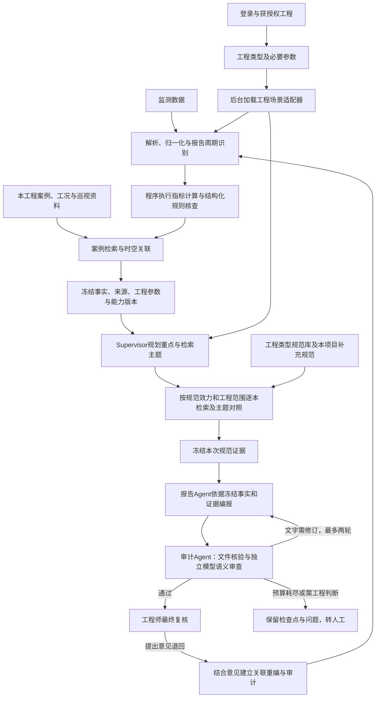

# ExcavaGuard · 基坑智守

面向工程监测研判与可复核报告生成的多智能体系统。以基坑为首个应用场景，目前已接入隧道变形监测，通过**通用三Agent、通用Skill与工程场景适配器**复用同一条业务链。

系统承担数据整理、确定性计算、规则核查、规范查证和报告编写，为工程师提供有据可查的草稿与问题清单。确定性程序负责计算与规则核查的可靠执行，Agent承担上下文分析、证据组织和意见驱动修订，工程师保留最终判断。**计算与风险等级由程序产生，模型组织分析与建议，工程师保留最终判断。**系统内的接受不等于正式工程签发，不自动发布预警。

> 更新日期：2026-11-05。本文说明当前工作区实现；历史方案与验收记录见文末链接。最新变更待用户确认后推送，不代表已经发布到上游仓库。

## 本轮整体优化

以“指定工程、指定周期的可复核报告草稿”为交付目标，主线为：**场景适配与判据匹配 → 确定性计算、规则判级与事实冻结 → Supervisor查证 → 报告Agent编报 → 审计Agent核验 → 工程师确认**。三Agent继续负责查证重点、证据组织和独立审查，计算与判级由程序执行。

准备层和Agent层共用事实一致性校验；辅助资料随事实冻结，续跑不能替换，保存检查点使用副本。规范检索覆盖与实际可执行规则分别展示；项目新规范经提取、校验与集中确认后才能形成执行规则。详见[整体框架与边界](方案与迭代note/34_第一性原理与整体框架边界.md)。

## 当前使用流程

```text
登录 → 选择获授权工程
         └─ 新建工程时只选择：基坑工程 / 隧道工程
    ↓
确认必要工程条件，保存后日常复用
    ↓
上传或选择监测数据，可汇集同工程多位成员的文件
    ↓
程序识别测项与时间范围 → 推荐日报、周报、月报或阶段区间
    ↓
确认本次报告周期；按实际测项补充必要控制要求
    ↓
生成报告 → 查看审查结果与具名依据 → 工程师接受、退回或拒绝
```

用户通过工程类型和业务参数操作。适配器、知识库连接及版本由后台管理，用户无需选择数据库或编辑工程配置JSON。隧道的工程类别、工法、阶段和特殊地质属于同一工程的参数；测项与日期由程序读取，不从一列监测数值猜测真实工法或项目归属。

## 主要框架



### 三Agent共用一套职责与编排

| 角色 | 通用职责 | 专业差异的来源 |
|---|---|---|
| Supervisor | 依据冻结事实与意见规划最多三项定向查证，记录新增证据与缺口、管理有限修订 | 适配器中的专业策略、规范目录、适用条件 |
| 报告Agent | 根据冻结事实与本次证据编写分析和建议，调用报告生成Skill | 适配器中的表式、分类和专业表达要求 |
| 审计Agent | 文件核验与独立模型语义审查，形成问题清单并交回对应角色 | 适配器中的专业检查要求；通用来源与完整性检查始终执行 |

工程事实冻结后，模型不能改写计算结果或风险等级，不能引用本次证据范围外的条文。自动修订最多两轮，未解决的问题交由人工处理。工程师退回意见进入关联运行，保留逐项回应与前后对照；涉及事实变更时需要对应的新数据或人工确认。

### 八个业务Skill共用接口

| Skill | 用途 |
|---|---|
| `parse-monitoring-data` | 解析监测文件、识别字段和可用数据范围 |
| `normalize-monitoring-data` | 数据归一化、单位与来源整理 |
| `evaluate-thresholds` | 调用专业程序计算指标、执行规则、生成弃权原因 |
| `retrieve-standard-evidence` | 检索适用规范，保留版本、定位与查询轨迹 |
| `retrieve-similar-cases` | 按测项、文本和已提供工程条件匹配案例 |
| `analyze-work-condition` | 关联时间与区段，披露缺失、冲突和待核事项 |
| `render-daily-report` | 按对应工程表式生成受控报告文件 |
| `validate-report` | 核验文件、事实绑定、引用范围与专业输出 |

六类Python处理入口由后台按适配器的`manifest.handlers`选择；案例、工况及规范检索读取对应专业策略。正式主链在基坑和隧道之间复用，专业计算与表式实现留在适配器内。`skills/deep-pit-monitoring-report/`为基坑历史参考资源，其独立重判与RAG脚本不接入通用主链。

### 工程场景适配器承载专业知识与执行能力

| 内容 | 具体职责 |
|---|---|
| 测项字典与数据语义 | 字段别名、测项映射、量纲、方向及输入含义 |
| 计算与规则 | 可执行的计算处理器、适用条件、控制值来源、缺项弃权 |
| 规范检索 | 独立知识库、规范目录、效力状态、工程范围与废止条款过滤 |
| 报告与核验 | 专业表式、表达要求、文件审计和专业检查 |
| 版本与评价 | 资产指纹、知识库清单、测试输入与预期、软件对照及工程师复核记录 |

新增工程场景需要制作并验证完整的专业适配内容、登记工程类型，随后接入通用三Agent与Skill。单独更换RAG不等于完成迁移；规范原文也不会自动变为可执行的数值判据。

隧道共用一个在用处理入口。盾构、矿山／钻爆、明挖及不同测项通过工程参数和数据路由处理，不各建一套子适配器。历史参数与辅助资料兼容保留，历史资源不作为另一个用户选项。

## 主要更新

| 更新 | 当前实现与意义 |
|---|---|
| 工程类型统一 | 前端只显示基坑工程、隧道工程；必要条件一次确认后复用，专业配置留在后台 |
| 三Agent与Skill通用化 | 调度、编报、审计闭环共用；计算、规范与报告差异由适配器提供 |
| 隧道全规范知识库 | 已处理16本PDF、2602页，形成2595条候选；逐本验证原件哈希及实际召回，与基坑库隔离 |
| 数据驱动的参数与周期界面 | 上传后识别测项和时间范围；隧道按实际测项提供输入含义、控制值依据及限值确认表单 |
| 多周期报告 | 日报、连续7个日历日周报、完整自然月报、自定义区间；展示逐日变化、阶段风险、缺测与待核事项 |
| 多日预警追加查证 | 同点同测项至少两天预警时扩大主题查证，继续遵守工程范围和有效版本门禁 |
| 项目补充规范 | 本工程地方标准、行业标准及专项要求独立保存，进入本工程报告检索；不推广到其他项目 |
| 案例与工况接入 | 支持CSV、可搜索PDF等资料，结合工程条件匹配案例，按时间区间和位置关联工况／巡视 |
| 工程师意见闭环 | 接受、退回、拒绝绑定当前草稿和修订；退回意见用于关联重编，保留问题回应与修订轨迹 |
| 多端协作与权限 | 独立账号、获授权工程、四类角色；同工程共享数据和报告，多文件可统一生成报告 |
| 追溯与发布管理 | 原件与产物哈希、事实和证据快照、不可变运行修订、知识库与专业资产版本、发布归档验证 |
| 专业评价入口 | 可下载测试输入、预期及软件结果，授权工程师逐项评价；软件通过不自动等同专业认可 |

近期详细记录：[通用框架重构](方案与迭代note/26_通用三Agent与场景适配器重构.md)、[案例与工况接入](方案与迭代note/27_案例检索工况分析与迁移提升.md)、[隧道全规范RAG](方案与迭代note/29_隧道全规范RAG与分类适配器.md)、[工程类型统一](方案与迭代note/30_工程类型统一入口与隧道参数路由.md)。

## 计算、RAG与报告的边界

### 计算及规则核查

程序依据数据语义计算累计量、本次变化、实际间隔速率和趋势，并使用结构化规则及已确认的项目控制要求判定。专业条件或依据不足时返回“未知”及原因，进入待核队列，不能解释为安全。

当前隧道数值能力覆盖**地表沉降、建筑沉降、拱顶沉降、净空收敛**。控制值按测项分别确认，沉降与收敛不互借限值；原始断面距离不能直接当累计收敛量。高程基准变化须核对，时间统一按上海时区归属报告并保留原始时间。气体、应力、水压等其他隧道测项尚不属于已验证数值能力。

### RAG调度与隔离

结构化数值规则核查发生在事实冻结前；运行时RAG在Supervisor阶段用于规范要求查证、条件对照和分析举证，不自动覆盖冻结判据。

| 资料范围 | 检索与使用方式 |
|---|---|
| 基坑公共规范 | 当前配置目录包含29个规范编号，可走Pinecone或本地BGE＋Chroma证据服务；按适配器绑定和服务配置选择 |
| 隧道公共规范 | 独立SQLite候选库，中文关键词与BM25风格排序；按工程系统、工法、阶段和特殊条件筛选 |
| 项目补充规范 | 仅当前获授权工程参与检索，保存原件及版本；同编号上传不能绕过已知效力和适用范围门禁 |
| 项目案例、工况及巡视 | 辅助关联与核验资料，单独管理；不能充当规范阈值或证明因果 |

程序先逐项检查规范目录的效力与适用范围，对可用规范逐本检索，再围绕实际测项跨规范查证。结果记录命中、缺口、跳过原因和同主题对照；用户可见引用展示**规范名称、编号及条文／PDF页码**。未命中不代表没有要求，追加检索也不等于实时全网标准查新。

隧道2595条内容是经过提取／OCR的检索候选，属于知识库构建，未微调大模型，也不是向量模型训练。其中13本标为有效候选、2本效力更新待核、1本为历史废止资料；后两类不进入现行依据分析。已识别废止条文所在页保守排除，另有4个文字不足页面未生成文本候选。OCR、图表公式及具体条文适用性仍需原页复核，详见[隧道入库与有效性说明](方案与迭代note/29_隧道全规范RAG与分类适配器.md)。

### 报告与人工复核

交付为`Excel + 封面Markdown + 附表及清单Markdown`，表式由工程专业配置决定。周期附表保留每通道区间最严重的原观测及日期，不将其写成期末值。缺失巡视资料明确披露“未提供”，不写“巡视正常”；关联线索与记录冲突交工程师核验。

文件完整性与事实／引用绑定核验、独立模型语义审查均通过后，AI草稿进入工程师复核。模板模式用于计算与表式检查，不代表已经完成模型语义审查。审查失败、预算耗尽或依赖不可用时保留检查点及明确状态，不以未完成结果冒充完整AI报告。

## 协作、权限与存储

- 登录后只可选择获授权工程；上传、生成、查询、下载和复核均绑定当前工程。
- 角色为项目管理员、复核工程师、工程师、只读成员；接受前须完成已判定非正常风险的逐项评价。
- 同一工程可汇集最多10份、合计100 MB监测文件；跨文件重复观测或语义冲突须核对来源。
- 同工程共享文件、历史和评价，工作台定时同步；旧修订并发写入返回冲突，不覆盖他人修改。
- 监测文件、运行修订及报告可采用本地存储或Supabase私有存储，以部署配置为准。
- 账号目录、项目补充规范库、辅助资料及专业复核记录等本地状态需要单独持久化；切换存储Provider不会自动迁移原有资产。

Supabase服务端凭证仅供受保护后端使用，业务权限校验不能由数据库管理员权限替代。现有Supabase部署还需执行[协作字段迁移](supabase/migrations/202611020001_collaboration.sql)，并检查`collaboration_ready`。账号与成员操作见[登录与项目授权](方案与迭代note/20_登录与项目授权切换验收.md)，部署见[服务器部署说明](deploy/README.md)。

## 本地启动

Node版本要求以`package.json`为准；当前WSL已使用Node 24验证，`.nvmrc`另记录Node 26.3.1。Python需安装报告与文件读取依赖。以下在项目根目录执行：

```bash
# 使用Linux环境中的node/npm；先确认当前路径
pwd
which node
which npm

python3 -m venv .venv
source .venv/bin/activate
python -m pip install -r deploy/requirements.txt
npm ci
```

首次配置时将`.env.example`复制为`.env.local`；已有配置应保留，按需补充。基本本地模式设置`EXCAVAGUARD_STORAGE_PROVIDER=local`。AI模式还需配置`LLM_API_KEY`、`LLM_BASE_URL`、`LLM_MODEL`及当前工程类型的检索资源；模板模式不调用LLM，公共规范RAG也不调用，但可使用本项目补充规范。

```bash
npm run dev
```

打开 <http://localhost:3000/workbench>。端口占用时使用`npm run dev -- --port 3001`。指定Python解释器可设置`EXCAVAGUARD_PYTHON`。

**WSL启动需使用WSL内的Node/npm。**若命中了Windows的`npm.cmd`，可能出现UNC路径、React或app目录找不到等错误。项目本机若已配置`.tools/node`，可先执行：

```bash
export PATH="$PWD/.tools/node/bin:$PATH"
source .venv/bin/activate
npm run dev
```

首次初始化独立管理员账号：

```bash
node --env-file-if-exists=.env.local tools/access/manage.mjs init --username admin --name 管理员
```

工具只在首次初始化时生成本地凭证文件，并打印实际位置；已有账号使用管理工具维护，不重复初始化。私有账号文件和`.env.local`不进入Git。完整安装及平台差异见[部署指引](DEPLOY.md)。

### 隧道知识库部署

生成的隧道SQLite索引不随Git提交。新克隆部署应离线构建或复制经过清单校验的索引；仅拉取代码不保证隧道AI检索已就绪。本地打包会携带已生成的索引。

持有目录内原始规范PDF时，可在Python虚拟环境中执行：

```bash
python -m pip install -r tools/knowledge/requirements-ocr.txt
python tools/knowledge/build_tunnel.py --workers 8
npm run tunnel:verify
```

构建读取工作区的`隧道施工相关规范/`及受控源清单，原件保持只读，按文件哈希缓存逐页结果；OCR只在离线构建时运行。资源位置、配置校验与专业边界见[隧道专业配置说明](engineering-adapters/tunnel-monitoring/README.md)。基坑本地BGE＋Chroma服务的模型依赖、Git LFS资产和独立Demo见[source/README.md](source/README.md)，它不是统一工作台的替代入口。

## 验证状态

以下为截至2026-11-04的验收记录，不是每次启动自动执行的结果，也不代表真实工程效果评价。

| 检查 | 结果与范围 |
|---|---|
| 全量Web／服务端回归 | 236项通过，6项外部服务测试默认跳过 |
| 架构与工程类型复核 | 最近针对迁移、路由和报告链的32项测试通过 |
| Python确定性引擎 | 242项通过 |
| Node周期报告 | 13项通过 |
| 工程质量检查 | TypeScript、ESLint、Next.js生产构建通过 |
| 隧道全库 | 16本原件哈希与逐本候选召回验证通过 |
| 多场景报告重放 | 轨道矿山、公路岩溶矿山、轨道盾构使用真实本地RAG与模拟模型生成日报，通过文件审计；区间样例验证多日预警追加检索 |
| 真实模型样例 | 公路岩溶日报使用模拟监测数据与真实本地RAG，约28.3秒、5次模型调用、1轮自动修订，最终文件与独立语义审查通过 |
| 专业评价 | 隧道6项软件对照通过、1项待人工核查；尚无真实工程师正式签认 |

真实模型样例证明一次闭环可运行，不是稳定性、引用准确率、工程风险准确率或生产时延承诺。工作区测试数据及验收产物按日期保存在`测试数据/`、`验收结果/`，中间日志在`process_file/`；这些工作区资料不等同于仓库克隆后的默认资产。

开发与复核命令：

```bash
npm run check
npm run build
npm run test:period
npm run test:standards
npm run test:project-standards
npm run adapter:validate -- tunnel-monitoring
npm run adapter:evaluate -- tunnel-monitoring
```

本机已有独立账号时，接口测试宜指向专用临时账号目录，避免开发测试受到真实登录设置影响；不要为测试覆盖真实凭证。外部服务回归需单独配置并显式运行`npm run ai:test`、`npm run rag:test`、`npm run supabase:test`，默认跳过不视为外部服务已验证。

## 代码与资料位置

```text
src/app/workbench/              统一工程工作台
src/app/api/                    登录、工程、上传、运行、报告与复核接口
src/server/agents/              通用三Agent编排、模型调用与审查
src/server/skills/              八个业务Skill的通用服务端接口
src/server/engineering-adapters/ 专业配置加载、工程类型路由与版本核对
src/server/evidence/            规范证据接口、检索与工程范围门禁
src/server/context/             本工程辅助资料管理与冻结
src/server/storage/             本地／Supabase存储
src/contracts/                  数据与运行契约
engineering-adapters/           专业计算、规则、规范、报告与评价资产
skills/                         Skill契约、桥接入口及历史参考资源
确定性计算层/                   计算引擎及基坑专业基础实现
tools/knowledge/                隧道离线知识库构建与逐本验证
tools/adapters/                 专业配置校验、评价及发布归档
tests/                          契约、权限、接口、计算及编报审计回归
var/                            本机私有数据、运行与生成资源（不提交）
方案与迭代note/                 设计、变更和验收记录
```

Web前后端共用Next.js应用，`src/server/`通过`server-only`隔离；Node通过受控Python子进程调用专业实现。当前主要依赖为Next.js 16.4.3、React 19.3.0、TypeScript 6.0.3、Zod 4.6.5，精确版本以`package-lock.json`为准。

## 三Agent作用的验证

保持原三角色和确定性计算、冻结事实主链，新增有界的Supervisor查证任务及界面贡献展示。真实模型的同场景对照中，完整三Agent提出3项查证，补充5条基础检索未保留的候选，其中4条用于正文；报告Agent回应2条模拟工程师意见；语义故障注入验证了审计对“关联写成因果、无依据认定现场正常”的拦截。各组冻结输入与计算判级一致。

初轮还发现自动审计漏检了计数当等级、部分超限写成全部超限和确认主体扩张，现已补强并保留失败产物。上述为模拟场景的功能证据，不能宣称三Agent在所有任务都不可替代或工程效果已获专业认可。方法、成本与边界见[三Agent作用验证](方案与迭代note/31_三Agent作用验证与受控查证.md)。

## 待完善与迁移条件

- 获授权的真实工程配套数据、工程师确认的规则与报告样例，以及系统性的引用质量与风险评价。
- OCR原页校订、图表／公式核验、待核规范效力确认及尚缺新版规范补齐。
- 其他隧道测项、工法细节与更多工程场景的专业计算和判据验证，不能以增加规范数量替代适配。
- 异步worker／任务队列、自动恢复和多实例状态管理；当前为同步执行器、检查点及显式续跑。
- 自助注册、企业SSO／Supabase Auth、多实例授权，以及正式签发与工程档案系统。
- 温度补偿等尚未实现的专业处理、持续部署及真实业务条件下的稳定性评测。

## 继续阅读

- [工程类型统一与当前业务流程](方案与迭代note/30_工程类型统一入口与隧道参数路由.md)
- [隧道全规范RAG及有效性边界](方案与迭代note/29_隧道全规范RAG与分类适配器.md)
- [工程场景适配器技术说明](engineering-adapters/README.md)
- [多周期报告](方案与迭代note/14_多周期报告使用与验收.md) · [项目补充规范](方案与迭代note/18_项目补充规范上传与隔离验收.md)
- [工程师意见重编](方案与迭代note/23_工程师意见重编与日报信息补齐.md) · [多端协作](方案与迭代note/23_多端协作与共享日报.md)
- [部署](deploy/README.md) · [Supabase迁移](supabase/README.md) · [可复现周报样例](final_test/latest/README.md)
- [更新记录](update.md) · [项目记忆](memory.md) · [协作约定](AGENTS.md)

## 项目补充规范：从检索到规则确认

工作台“项目补充规范”新增“规范变更审查与确认”：三Agent提取要求、整理关键差异并独立审计，工程师可逐条接受、修改或退回，最多两轮修订。确认后的项目规则参与后续确定性核查，并随事实冻结；支持已有记录只读影响试算和停用回退，不改写历史报告。

当前自动执行限定为适配器支持的毫米变形测项、正向累计量/速率固定阈值及等值条件。区间、公式和未能可靠结构化的要求保留待核，不把所有RAG文本自动当成判据。补充规则只增加提醒，不降低原等级。详见[规范变更审查与规则发布](方案与迭代note/32_项目规范变更审查与规则发布.md)。

## 三Agent前的两个板块

前置流程统一为“①场景适配与判据匹配 → ②确定性计算、规则判级与事实冻结”。前者固定本次工程设置与判据来源，后者执行计算并形成来源清楚、可校验的事实包；结果页展示实际采用依据、观测范围及待核数量。专业差异继续由工程适配器提供，三Agent主体保持一致。见[前两板块与事实交接](方案与迭代note/33_三Agent前两板块与事实交接.md)。
