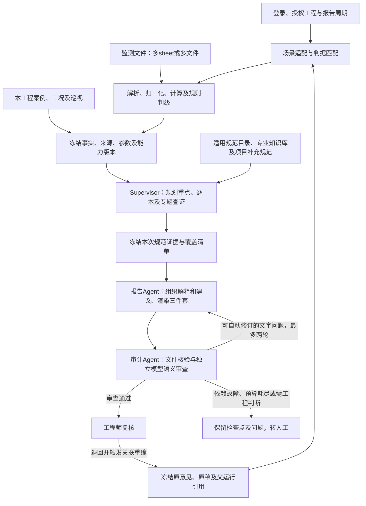

# 当前展示逻辑与系统架构梳理

更新日期：2026-11-18。依据当前工作台、运行服务、三Agent、适配器及38—41号验收记录。本文为现状梳理和展示组织建议，本次未改界面或业务代码。

## 1. 项目应传达的主线

指定工程与周期的原始监测数据，经过可复现计算和规则判级、逐本规范查证、受约束编报与独立审查，形成工程师可复核的报告草稿；工程师退回意见进入关联运行，生成可对照的新稿。

展示围绕“数据进来 → 事实算清 → 依据查明 → 草稿生成 → 独立核验 → 工程师修订”展开。模型贡献、程序计算、专业资产和人工责任分别说明。

## 2. 当前页面的实际组织

- `/`是介绍与导航页，展示项目定位、三角色职责及工作台入口，没有真正的数据上传操作。
- `/workbench`是真实业务入口，登录后选择授权工程；管理员可创建工程并选择基坑或隧道。
- 工作台提供共享运行历史、案例/工况/巡视资料、工程条件、监测上传及多文件选择、项目规范、可选结构化阈值、运行分析。
- 当前步骤条仍为“工程条件 → 上传监测数据 → 用户规范（可选） → 运行分析”。
- 结果区包含两项前置准备摘要、交付及轨迹、规范来源、意见回应、风险与待核、逐项明细、质量及周期统计；历史支持载入、关联重编和有条件续跑。
- 报告默认开启AI模式；模板模式用于确定性表式检查。隧道模板也执行全规范逐本核查，但不执行模型语义审查。

## 3. 对用户的展示顺序

| 环节 | 用户做什么 | 展示中说明什么 |
|---|---|---|
| 确认工程 | 登录、选择工程、保存必要参数 | 工程范围、工法、测项语义和控制要求有明确来源 |
| 接入资料 | 上传Excel/CSV，可多sheet或多个文件 | 系统自动读取规范结构的数据，不要求手工拆/合表；缺列及重复明确反馈 |
| 选择周期 | 日报、周报、自然月或自定义区间 | 完整历史用于计算，报告只交付所选时间范围 |
| 看计算事实 | 查看数量、风险、未知与来源 | 累计量、变化量、真实间隔速率和趋势由Python程序计算 |
| 看规范依据 | 查看逐本覆盖、条文、原文、页码 | 全目录核查；适用且有效的规范逐本检索，其他条目说明原因 |
| 看报告与审查 | 查看正文、表格、审计及下载 | 模型组织解释，文件与独立语义审查通过后才完整交付AI草稿 |
| 做工程师复核 | 评价、接受/退回/拒绝 | 退回意见随关联重编冻结，有原意见、回应和真实正文前后对照 |
| 看历史 | 对照原稿与新稿、来源和修订 | 原版本不覆盖，相关运行可追溯 |

补充规范、案例、工况与巡视是可选输入。缺少辅助资料须披露，但不把“未提供”当作现场正常；专业判据缺项则明确未知。规范数量应和本工程实际适用数量分别展示。

## 4. 后台主流程与职责

三Agent之前的两项准备由通用服务组织、专业适配器提供能力。它们不需要另外增设两个模型Agent。事实冻结是计算层与模型层之间的交接边界，模型不能改写数值或判级。

## 5. 分层架构

| 层 | 主要实现 | 责任 |
|---|---|---|
| 用户界面 | Next.js/React，`src/app/workbench/` | 工程选择、资料、周期、结果、复核及历史 |
| API与权限 | `src/app/api/`、`src/server/access.ts` | 身份/工程/角色约束、请求校验、上传与下载 |
| 运行与准备服务 | `src/server/runs.ts`、`src/server/preparation/` | 固定参数和判据来源、组织计算、来源与事实一致性、运行检查点 |
| 三Agent | `src/server/agents/` | Supervisor规划查证，报告Agent编写，审计Agent独立质疑与有限修订 |
| 核心Skill | `src/server/skills/`、`skills/` | 解析、归一化、阈值核查、规范检索、案例检索、工况分析、报告生成、报告校验八项核心操作 |
| 专业适配器 | `engineering-adapters/` | 专业测项、语义、规则、规范范围、Python执行入口、表式、模型专业约束与专业检查 |
| Python计算与渲染 | `确定性计算层/`、适配器`runtime/` | 单位和时序、数值、阈值及弃权、Excel/Markdown渲染和逐值审计 |
| 证据服务 | `src/server/evidence/`及专业知识库 | 效力/工程范围过滤、逐本与专题检索、具名来源、覆盖和缺口 |
| 存储与追溯 | `src/server/storage/`及本地辅助库 | 本地/Supabase文件和运行存储，不可变修订、哈希、事实/证据快照和报告元数据 |

Web服务端通过受控Python子进程调用登记的专业处理器；TypeScript不重写已有工程判定。契约集中在`src/contracts/`，约束请求、冻结事实、证据、草稿、审查与意见结构。

### 三Agent各自的价值

- Supervisor：根据已有事实与工程师意见选择重点，组织强制规范目录覆盖和受控追加查证；不更改原始判级。
- 报告Agent：把事实、规范候选、辅助资料组织成解释、建议与意见回应；数值及来源须绑定冻结内容。
- 审计Agent：先调用文件校验，再独立审查模型文字是否有依据、是否误用数量或口径、是否越过责任边界。失败交回相应角色或转人工。

### 专业适配器的作用

通用主链在基坑与隧道之间复用，测项语义、规则、知识库范围、表式及专业核验放适配器。隧道的地表沉降、建筑沉降、拱顶沉降、净空收敛共用隧道入口，盾构/矿山法/明挖等以工程参数区分，不为每个工法另建一套Agent。

新增场景须同时建设并验证数据语义、计算规则、规范、表式及专业审计；不能只替换规范PDF或模型提示词。

## 6. 两条规范路径与两类修订

### 日常规范查证与规则配置

- 日常报告：按目录逐项检查效力与范围，对可用规范逐本检索，冻结条文候选、原文定位和覆盖结果，支持解释与复核。
- 项目规则变更：补充规范 → 模型辅助提取候选 → 程序核验 → 工程师逐项确认/发布 → 新运行加载结构化规则。当前仅覆盖已支持的固定阈值和明确条件，不能声称任意公式和条文已自动执行。

规范检索目录、实际命中证据和真正执行的数值判据，是三个不同概念。隧道样例中16本目录全部有核查记录，本工程5本适用候选命中，另外11本说明未采用原因。

### 审计自动修订与工程师退回

- 审计退回：同一运行中针对报告文字问题最多自动修订两轮，受调用和时间预算约束。
- 工程师退回：保存复核意见，用户选择“载入输入并按退回意见重编”后重新运行；新运行关联父版本，保留原意见、逐项回应和前后对照。

提交退回意见本身不会在后台自动启动新任务。若要变更事实、控制值或测项映射，需要相应的新数据/专业确认；报告文字修改不能消除冻结超限事实。

## 7. 可直接使用的演示顺序

1. 选择隧道工程，简要确认工程类别、工法和控制要求。
2. 打开七天十分钟模拟Excel，说明四个数据sheet、24通道和24192条观测；上传后核对解析数量。说明拆成四个文件也可统一分析。
3. 选择11月17日日报，展示3456条当日观测及风险；解释已判风险与未知的区别。
4. 展示“场景适配与判据匹配”“计算、判级及事实冻结”两项交接摘要。
5. 展示规范覆盖清单和一个可定位原文的引用，区分目录覆盖和实际适用性。
6. 下载并打开Excel，先看概况和分析，再看成果、来源及规范清单；展示文件/语义两层审查状态。
7. 提交累计/速率区分、零变化平台等工程师意见并退回，载入后重编。
8. 对照新版正文、意见回应与修订前后表，确认原始数值及风险未改、原稿保留，形成完整闭环。

主要材料：`测试数据/隧道模拟_7天_10分钟_2026-11-18/`、`验收结果/2026-11-18_隧道工程师意见修订/`。演示真实模型耗时应按实际等待或明确删节，不能将剪辑时长冒充运行时延。

## 8. 展示与实际能力的落差

| 当前展示 | 与当前实现的差异 | 后续展示调整方向 |
|---|---|---|
| 侧栏“基坑监测日报助手” | 已有基坑与隧道适配 | 产品定位覆盖工程监测报告 |
| “可视化测试工作台”“初始版本” | 已有上传、AI审查、交付、人工修订闭环 | 将业务入口与技术调试说明区分 |
| 步骤条停在“运行分析” | 规范查证、审计、工程师修订是重要后半程 | 把报告交付及复核闭环纳入主线 |
| 页面开场“页面只展示引擎载荷” | 已展示报告、语义审查、意见回应和历史 | 按完整报告流程描述当前能力 |
| 多处固定称“日报” | 已支持周/月/自定义周期 | 报告周期名称随选择呈现 |
| 数据、规范与参数配置内容较多 | 用户需先理解主任务，额外资料可选 | 主线突出上传—周期—报告—复核，专业配置与辅助资料逐步展开 |

这些是展示层调整建议，本次未实施界面改版。当前仍为同步执行器与显式检查点续跑，尚无异步worker/企业SSO/正式工程签发及档案系统；模拟与软件验收不能当作真实工程专业认可。
