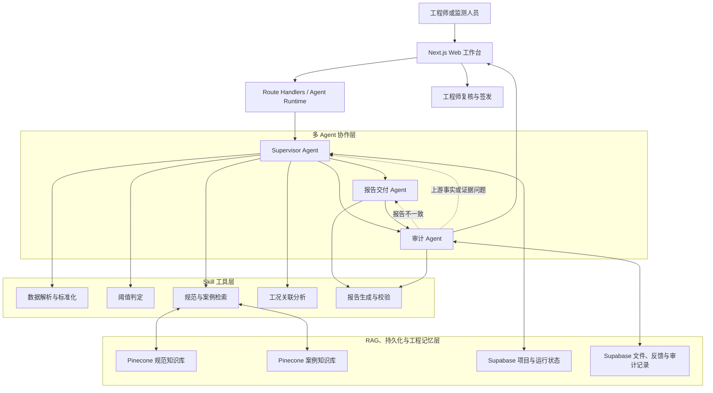
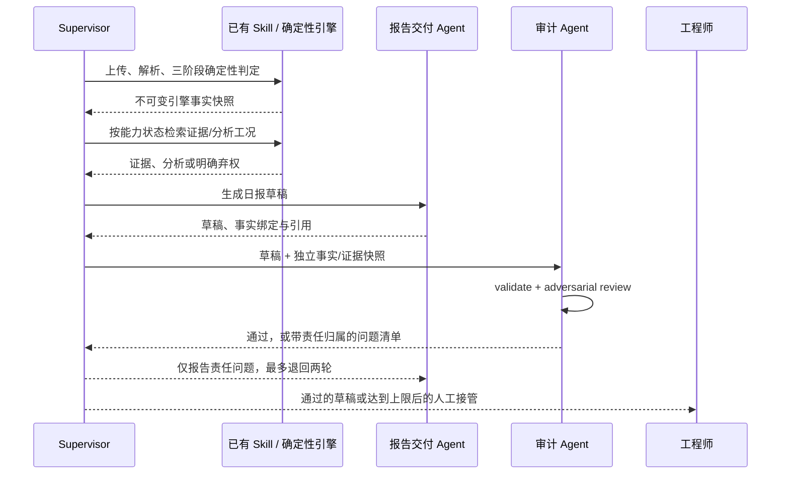

# ExcavaGuard Skill 编排与多 Agent 框架 Demo

## 一、框架定位

ExcavaGuard 采用五层架构：

1. Web 交互与应用层负责对话、文件上传、运行轨迹、人工确认和日报预览。
2. 多 Agent 协作层负责理解任务、规划流程、选择能力、处理冲突和组织交付。
3. Skill 工具层负责执行边界明确、可以测试和复现的业务操作。
4. RAG、持久化与工程记忆层负责提供规范、案例、项目状态和历史反馈。
5. 确定性规则层负责全部数值计算与阈值判断。

核心关系可以概括为：

> Agent 负责决策与协作，Skill 负责可靠执行，RAG 负责提供证据，规则引擎负责工程事实，工程师负责最终签发。

多 Agent 的价值不在于角色数量，而在于形成规划、执行、质疑、退回和人工确认的完整过程。

> **2026-10-12 首版收敛决策**：运行时只保留 `Supervisor`、`报告交付`、`独立审计`
> 三个逻辑 Agent。数据解析、数据准备、确定性计算、规范比对和证据检索继续作为
> Skill / 服务能力，由 Supervisor 按状态调用，不再为每项能力额外设置 Agent。

## 二、总体架构



### 2.1 实现形态

- 主交付是独立 Web 应用，不依赖桌面 Agent 软件才能运行。
- MVP 采用 Next.js + TypeScript 单体全栈，Route Handlers 承载服务端接口，不额外拆分 Python 后端。
- 首版使用显式 TypeScript 状态机管理共享状态、条件路由、重试、退回和人工确认；
  当前不引入 LangGraph.js。后续只有在状态图复杂度确实超过本地实现时再评估框架。
- 三个 Agent 是单一应用进程中的逻辑角色，不要求三个模型或三个独立服务。
  Supervisor 首版不依赖模型；报告交付与审计可以使用同一模型供应商，但必须是独立调用，
  并具有独立输入、工具白名单、结构化输出和终止条件。
- Zod 负责运行时数据契约；Supabase PostgreSQL/Storage 保存工程状态、会话、文件和审计记录；Pinecone 保存规范与案例向量索引。
- WorkBuddy 专家、企业智能体或 MCP 接入只作为主链路完成后的附加适配，并复用同一套 Skill、规则和检索能力。

### 2.2 初始化代码范围（2026-10-09）

本轮先建立可启动的应用骨架，不等同于完整 MVP：

- `src/app/`：App Router 页面、布局及 `api/health`、`api/runs` Route Handlers。
- `src/components/`：工作台空状态、流程说明等界面组件。
- `src/contracts/`：运行请求、角色与 Skill 标识的 Zod 契约；禁止引用服务端模块。
- `src/server/agents/`：三类角色及工具白名单；Supervisor 显式状态机与报告/审计
  Skill 基础已落地，端到端执行器和 API 尚待接入。
- `src/server/skills/`：八个既有 Skill 的契约路径与实现状态；确定性实现仍放在根目录 `skills/<name>/scripts/`。
- `src/server/integrations/`：LLM、Supabase、Pinecone 的延迟初始化入口，密钥仅在服务端读取。未指定模型前不提供默认模型。
- `tests/`：接口边界、配置校验和注册信息一致性测试。

`GET /api/health` 只表示应用进程可响应，不代表外部服务可用。`POST /api/runs` 已接通
Python 确定性引擎并同步返回 `excavaguard.daily_report_input/v1` 载荷，但尚不做鉴权、
项目归属校验或运行记录持久化。Agent Runtime 消费该载荷，不替代或重写其中的判定。

### 2.3 规范证据检索 Provider（2026-10-13）

规范 RAG 通过统一的 `StandardEvidenceRetriever` 服务端接口接入，不让页面、Agent 或 Skill 依赖具体向量库。当前先提供两种适配器：

- `PineconeStandardEvidenceRetriever`：面向托管索引，使用 Pinecone integrated embedding；
  文档上传与查询均发送文本，由同一索引模型生成向量，主应用不再注入另一套查询 Embedding。
- `LocalStandardEvidenceRetriever`：面向本机 loopback HTTP 服务。默认调用 `POST /api/evidence/search`；
  本地 BGE、ChromaDB 和规范文本已进入仓库，但正式运行必须使用 gitignore 的运行时副本，
  不得直接写版本化的 `data/chroma_db/` 发布基线。

两个 Provider 必须返回同一份经过 Zod 校验的证据结构，包括稳定证据 ID、规范名称、版本、条文号、原文、适用条件、来源位置、生效状态、匹配分数和 Provider 标识。缺少上述字段的旧版检索响应视为不完整证据，适配器应拒绝返回，不得在主链路中补造。

服务端通过 `RAG_PROVIDER=pinecone|local` 选择 Provider。选择本地模式时地址仅允许
`localhost`、`127.0.0.1` 或 `::1`，避免把“离线模式”静默指向远端服务。

Pinecone 导入采用独立、可审计的离线步骤：

1. 从 `data/chunks.jsonl` 与默认规范库索引进行精确映射；
2. 排除项目内部文件、无条文号切片和同一规范的非首选 OCR 副本；
3. 从人工维护的状态清单读取 `active` / `inactive` / `unknown`，不得根据文件名猜测现行性；
4. 生成运行目录下的导入记录与审计报告；
5. 只在全部规范状态已复核、来源映射无冲突且显式指定执行参数时创建索引或上传。

在线索引的模型和语义文本字段通过环境变量配置；当前目标索引使用 NVIDIA
`llama-text-embed-v2` 和 `text` 字段。导入清单内部统一保留 `chunk_text`，上传时再映射到
索引字段。索引记录保留原始 chunk ID、规范编号、名称、条文号、OCR 来源路径、适用范围
和生效状态。导入模型一经确定，查询必须继续使用同一 integrated embedding 索引；
不得把本地 BGE 向量与在线模型向量混用。

截至 2026-10-13，29 个规范编号已完成人工复核，`excava-guard / standards-v1`
已导入 7,180 条记录；远端记录数及真实查询返回的正文、条文号和来源位置已与本地清单核对一致。

`retrieve-standard-evidence` 负责统一返回证据、适用性提示和检索轨迹。它不判断监测值是否
超限，不把低相关结果补造成依据；无命中、非现行证据或 Provider 不可用时主动弃权。
本地 FastAPI 已新增 `POST /api/evidence/search` 并通过真实 BGE/Chroma →
Next.js Retriever/Skill 兼容验收；旧 `GET /api/search` 留作历史入口。
前端展示及当前三 Agent 同步 API 仍未自动调用这一证据能力。

#### 本地 Provider 兼容实现设计（2026-10-13）

在 `source/server.py` 增加 `POST /api/evidence/search`，接受与 Next.js 相同的
`query / filters / top_k`，返回 `{"evidence":[...]}`。旧 `GET /api/search` 保留供
原型页面使用。新接口只检索证据，不调用 `report_core` 的旧判定或报告生成。

本地查询使用现有 BGE 模型和 Chroma 向量。规范名称、版本、适用范围和来源位置复用
`npm run rag:prepare` 生成的可审计清单；生效状态以 `rag/standard-status.json` 为准。
先筛选具备完整元数据且满足请求条件的稳定 chunk ID，再在 Chroma 中检索这些 ID，
不得把无条文号或无法确认来源的记录补造成证据。可选的测项/地区/等级过滤字段未登记时
返回无命中，不从问题文本猜测适用条件。查到的正文须与清单逐字一致。

首次启动把 `data/chroma_db/` 复制到 gitignore 的 `var/rag/chroma_db/`，所有
PersistentClient 只打开运行副本。模型必须完整存在于本机，离线 Provider 不回退联网下载。
加载模型在服务启动期完成，避免首个 Next.js 请求在模型冷启动时超时；失败返回明确不可用。
接口响应、错误和轨迹都不能泄漏密钥或底层异常正文。

## 三、Skill 职责

### 3.1 `parse-monitoring-data`

负责读取 CSV / TSV / Excel 数据、识别表头、核验必填字段并输出结构化原始记录。
除五列长表外，允许识别 `监测项目-测点号-量值语义(单位)` 形式的混合宽表；
宽表只能按明确表头展开，任何未识别通道都必须在读取报告中列出并拒绝静默丢弃。

它只保证数据能够被正确解析，不负责单位换算、异常判断或工程归因。文件不可读、表头缺失或没有有效数据行时，应停止流程并返回明确错误。

### 3.2 `normalize-monitoring-data`

负责统一点号、时间、监测项名称、方向、数值格式和长度单位，并检查重复记录和非法值。

该 Skill 将不同来源的数据转换为统一的数据契约，为后续计算提供稳定输入。未知单位、
无效时间或重复测点不得静默修复，应由 Supervisor 暂停流程并提交工程师处理。

混合宽表展开后必须额外保留：

- `measurement_semantics`：区分 `raw_observation` 与
  `precomputed_cumulative`；已有累计量使用语义零基准，不得以本次上传窗口首值重新归零；
- `source_flags` / `source_metadata`：记录工作簿级时间对齐、重采样、插值、
  末值保持限制以及源 sheet、列名和列号；
- `(point_id, metric_key)` 时序键：同一点号下的裂缝长度与宽度等不同测项不得串线；
- 宽表日报聚合：按通道保留截至报告日的每日末值历史，同时记录日内首末值、
  最小/最大值、最大相邻变化、样本数和源时间范围。日报层只能引用这些确定性统计，
  不能把日末平稳解释为日内无异常。

只有监测对象明确时才映射规范 `metric_key`。仅写“水平位移”或“裂缝宽度”但没有
测点对象台账时保留原名称，交由阈值阶段以 `UNKNOWN_METRIC` 弃权，不猜成围护墙位移、
建筑裂缝或地表裂缝。

### 3.3 `evaluate-thresholds`

负责根据项目配置的规则计算累计值、单次变化量和日变化速率，并形成逐测点的结构化判定结果。

所有计算必须由确定性脚本完成，输出需要包含输入值、阈值、公式、规则 ID 和超限状态。该 Skill 不负责解释异常原因，也不能自行从自然语言中推断工程阈值。

### 3.4 `retrieve-standard-evidence`

负责从规范知识库中检索与当前监测项、工程条件和规则相符的条文证据。

输出应包含规范名称、版本、条文号、原文、适用条件、来源位置和匹配信息。检索结果用于解释规则依据，不能替代规则引擎重新判断是否超限。

### 3.5 `retrieve-similar-cases`

负责根据支护形式、土层、地下水、施工阶段、监测类型、异常方向和变化速率等条件检索类似工程案例。

输出必须同时展示相似条件和差异项。历史案例仅提供经验参照，不能改变规范阈值，也不能把相似性直接表述为因果关系。

### 3.6 `analyze-work-condition`

负责将规则引擎确认的异常事实与施工工况进行时间、空间、方向和量级上的关联分析。

该 Skill 输出候选原因、支持证据、反证、局限性和可信等级。证据不足或相互冲突时，必须返回“信息不足，建议人工复核”。

### 3.7 `render-daily-report`

负责将结构化事实、规范证据、案例证据和归因结果填入批准的日报模板。

报告中的数字只能来自规则引擎输出，引用只能来自带证据 ID 的检索结果。输出必须标记为草稿，并保留事实字段与报告字段之间的绑定关系。

### 3.8 `validate-report`

负责在报告交付前检查数字、超限状态、规则 ID、引用、模板字段和责任边界。

发现不一致时只返回错误清单，不输出可以被误认为正式报告的成品。该 Skill 不修改事实来适应报告，也不代替工程师审核和签发。

### 3.9 日报实现资产映射

仓库中的 `skills/deep-pit-monitoring-report/` 是团队交付的完整日报生成与表式参考资产，
不是新增的第九个业务 Skill，也不新增 Agent。服务端只通过以下两个稳定契约使用它：

- `render-daily-report`：消费冻结的 `excavaguard.daily_report_input/v1` 引擎快照，
  复用其附录 A~G 表式映射与草稿组织经验；
- `validate-report`：独立核对草稿中的事实绑定、风险状态、引用、必填章节和责任措辞。

`deep-pit-monitoring-report` 自带的数值计算、阈值重判和本地 Chroma 检索是独立原型路径，
**不得进入服务端主链**。主链中的数字和风险等级只认 `evaluate-thresholds` 输出，
规范证据只认 `retrieve-standard-evidence` 返回的稳定证据 ID。适配层不得重算数值、
重新分级、用本地规则覆盖引擎事实，或把缺失单位和工程信息补造成确定值。

日报草稿的文件产物采用固定三件套，并作为 `ReportDraft` 的一部分参与内容哈希和审计：

- `监测日报_<报告日期>_草稿.xlsx`：封面、实际出现的附表 A～F、超限清单、
  待复核事项和来源说明；
- `监测日报_<报告日期>_草稿_封面.md`；
- `监测日报_<报告日期>_草稿_附表及清单.md`。

文件只能写入 `var/report-artifacts/<draft_id>/`。`ReportDraft.artifacts` 保存受控相对路径、
文件哈希、字节数和工作表清单，`artifact_bindings` 保存 Excel 单元格到冻结载荷字段的
绑定。审计必须重新读取文件并逐单元格核对。附表只按载荷中实际出现的测项生成；
未提供巡视记录时不生成表 G，同时在封面、待复核与来源说明中记录“巡视记录未提供”，
不得渲染成“巡视正常”。`measurement_semantics`、`source_flags` 和日内聚合统计只作
来源追溯，报告层不得据此重算或改变风险结论。

## 四、Skill 编排

### 4.1 正常流程



### 4.1.1 首版同步执行器与 API

`POST /api/runs` 默认行为保持为只执行三阶段确定性引擎并返回冻结载荷。调用方仅在显式
传入 `options.generate_report=true` 时，继续执行以下同步链路：

```text
engine payload
  → 构造带 SHA-256 的 engineSnapshot
  → 挂载可选 evidenceSnapshot / analysisSnapshot（当前 API 未提供时为 null）
  → Supervisor decideNextAction
  → render-daily-report
  → recordReportDraft
  → validate-report
  → recordAuditResult
  → 审计通过后停在 awaiting_human_review
```

执行器只消费 Supervisor 返回的结构化动作，不绕过状态转换。报告责任问题最多自动重渲染
两轮；上游责任问题、能力异常、预算或截止时间到达时停止自动处理并转人工。当前报告和
审计均为确定性能力，不消耗模型调用预算。API 响应可携带 `agent_run` 状态、终止动作、
执行步数和三件套下载地址。

三件套通过
`GET /api/report-artifacts/<draft_id>/<file_name>` 只读下载。下载端点只允许访问
`var/report-artifacts/<draft_id>/` 下由草稿清单生成的文件名，并阻止路径穿越。
本阶段运行状态仍为请求内内存态，未实现数据库持久化、恢复、用户鉴权或项目归属校验；
因此不能把该接口描述为可恢复的正式交付流程。

### 4.2 条件分支

Skill 不应始终机械地全部执行，Supervisor 根据中间状态动态选择路径。

| 条件 | 后续动作 |
| --- | --- |
| 数据字段缺失或单位未知 | Supervisor 暂停流程并请求人工补充 |
| 数据有效且没有异常 | 跳过案例检索和归因，生成常规日报 |
| 存在异常且工况完整 | 进入规范检索、案例检索和归因流程 |
| 存在异常但工况缺失 | 保留超限事实，归因部分主动弃权 |
| 未找到适用规范证据 | 禁止生成规范性解释，提交人工核验 |
| 没有高质量相似案例 | 不进行案例归因，但不影响超限事实 |
| 审计发现数字不一致 | 退回报告交付 Agent 重新生成 |
| 审计发现上游事实或阈值来源问题 | 不修改源事实，停止自动修订并提交工程师 |
| 证据冲突无法消解 | 停止自动流程，提交工程师裁决 |
| 报告或审计 Skill 未实现/未配置 | 返回 `CAPABILITY_UNAVAILABLE`，等待能力接入 |
| 报告自动修订达到两轮 | 停止自动流程，保留问题清单并提交工程师 |

## 五、多 Agent 设计

### 5.1 Supervisor Agent

Supervisor 是系统唯一的总控角色，负责：

- 理解用户目标并建立任务计划；
- 根据当前状态选择下一位专业 Agent；
- 维护任务阶段、运行次数和终止条件；
- 汇总专业 Agent 返回的结构化结果；
- 识别冲突并决定退回、重试或请求人工确认；
- 防止流程无限循环；
- 在审计通过后将报告提交工程师。

Supervisor 不直接计算监测数值，不直接编造工程结论，也不能绕过审计 Agent。

### 5.2 报告交付 Agent

报告交付 Agent 调用：

- `render-daily-report`

它根据已批准模板组织日报、异常摘要和证据说明。它只能消费不可变的引擎事实、
证据与分析快照，不能自行修改上游结果。每个数字、单位、日期、测点和风险等级都必须
通过 `fact_bindings` 绑定到结构化事实；证据不足时省略无依据解释并记录缺口。

### 5.3 审计 Agent

审计 Agent 调用：

- `validate-report`
- 必要时重新调用规范或案例检索 Skill

它采用反方视角检查：

- 数字是否与源数据一致；
- 阈值是否具有明确来源；
- 规范条文是否真的支持当前结论；
- 案例是否仅为表面相似；
- 相关性是否被错误表述为因果性；
- 是否出现自动预警、自动签发或过度确定的措辞；
- 是否遗漏关键数据缺口。

审计 Agent 发现问题后，必须退回责任 Agent，不得直接修改源事实。
数字与状态一致性优先由确定性校验完成；引用支持性、遗漏和责任措辞可由独立模型调用复核。
同一个模型供应商可以复用，但审计调用不得继承报告生成对话，也不得拥有报告写权限。

## 六、共享工程状态

所有 Agent 通过一个由 Zod 校验的结构化状态对象协作，避免依靠自然语言隐式传值。
首版先实现内存态与纯函数状态转换；持久化仍待数据库接入。聊天消息只用于交互，
不作为工程事实的唯一存储。

```json
{
  "schema": "excavaguard.agent_state/v1",
  "run": {
    "run_id": "",
    "status": "ready_for_report",
    "current_stage": "report",
    "revision_count": 0,
    "created_at": "",
    "updated_at": ""
  },
  "limits": {
    "max_revision_rounds": 2,
    "max_model_calls": 0,
    "model_calls_used": 0,
    "deadline_at": ""
  },
  "engine_snapshot": {},
  "evidence_snapshot": null,
  "analysis_snapshot": null,
  "report_draft": null,
  "audit_result": null,
  "human_review": {
    "required": true,
    "reasons": []
  },
  "trace": []
}
```

每个快照和草稿都携带独立的 `artifact_id`、Schema、版本与内容哈希。报告草稿的哈希
同时覆盖结构化报告、三件套清单与单元格绑定；草稿记录所依赖的引擎、证据和分析版本，
审计记录所检查的草稿哈希。修改报告内容或任一导出文件后旧审计结果立即失效，
替换引擎快照后证据、分析、草稿与审计全部失效；替换证据或分析时只清理受影响的下游产物。

每次 Agent 或 Skill 调用均向 `trace` 追加：

- 调用者；
- 被调用能力；
- 输入摘要；
- 输出摘要；
- 使用的规则或证据 ID；
- 警告和错误；
- 开始与结束时间；
- 是否触发重试、退回或人工确认。

未实现的 Skill 不得写入伪造产物。Supervisor 只返回下一步动作与
`CAPABILITY_UNAVAILABLE` 等明确原因，待真实能力接入后从同一状态继续。

## 七、冲突处理

### 7.1 规范冲突

当多个规范或项目专项方案给出不同要求时，系统保留全部来源、版本和适用条件，将冲突提交工程师。Agent 不通过投票选择工程事实。

### 7.2 规范与案例冲突

规范判据始终决定是否超限。案例只能解释可能原因，不能因为历史案例结果较轻而降低当前超限等级。

### 7.3 报告与事实冲突

结构化事实表是报告数字和状态的唯一来源。报告与事实不一致时，审计 Agent 退回报告交付 Agent，禁止通过修改事实迁就文本。

### 7.4 Agent 意见冲突

Supervisor 收集各 Agent 的依据，比较其数据来源、适用条件和可信等级。无法通过现有证据消解时，系统停止自动决策并请求人工确认。

## 八、记忆设计

后续可以把工程记忆分成四类：

| 记忆类型 | 内容 | 作用 |
| --- | --- | --- |
| 项目记忆 | 基坑等级、支护形式、阈值、测点布置 | 避免每天重复配置 |
| 过程记忆 | 历史监测值、施工事件、既往异常 | 支持跨日趋势和连续分析 |
| 人工反馈 | 工程师确认、修改或否决的结论 | 优化后续表述与字段映射 |
| 审计记录 | 每次使用的数据、规则、证据和输出 | 支持追溯与责任界定 |

记忆不应直接覆盖规范规则。人工反馈如果涉及阈值或规则变化，必须经过明确审批后进入项目配置。

## 九、智能体深度

比赛演示中的技术深度主要体现在以下能力：

- 动态规划：根据数据质量和异常状态改变流程。
- 工具调用：Agent 自主选择并组合不同 Skill。
- 多角色协作：不同 Agent 围绕同一个结构化工程状态工作。
- 反思审计：审计 Agent 主动寻找反证和不一致。
- 条件回退：错误被退回具体责任 Agent，而不是重新运行全部流程。
- 主动弃权：证据不足时停止归因。
- 长期记忆：结合历史数据和工程师反馈处理后续日报。
- 人机协同：关键冲突、预警和签发保留给工程师。

这些机制应当在系统运行轨迹和交互界面中可见，而不是只出现在架构图或答辩描述中。

## 十、Demo 场景

推荐准备三组独立样例，避免把“整批弃权”和“问题行隔离”混为一谈：

1. 数据错误样例：解析或判定 Skill 返回未知单位，Supervisor 停止下游调用并列出待确认项。
2. 正常样例：引擎确认无异常，Supervisor 跳过非必要归因，报告交付 Agent 生成常规日报草稿。
3. 异常样例：引擎保留超限事实；证据和工况能力可用时产出结构化辅助分析，否则明确记录缺口；报告交付 Agent 据此生成草稿。
4. 审计 Agent 发现数字不一致，将问题退回报告交付 Agent；修改草稿后旧审计立即失效。
5. 同一报告问题连续两轮未消解，或审计发现上游事实/证据问题时，Supervisor 停止自动修订并提交工程师。

Web 界面需要同步展示 Agent 当前阶段、Skill 调用、证据 ID、退回轨迹和人工确认入口。这个过程用于证明系统具备动态分支、工具调用、多 Agent 协作、反思纠错和人工责任边界，而不只是 RAG 对话。

## 十一、开发顺序

第一阶段稳定最小 CSV 契约和 Skill 错误边界，初始化 Next.js + TypeScript 应用，并为确定性 Skill 准备可人工核验的测试样例。

第二阶段建立 Zod 共享状态、服务端 Route Handlers 和 Supervisor，跑通“上传—解析—标准化—判定—基础草稿—校验”的纵向链路。

第三阶段接入 Supabase 与规范知识库，实现状态持久化、文件管理、证据引用和适用性过滤。

第四阶段接入案例库与受约束的风险归因，再加入审计 Agent、责任 Agent 退回、人工确认和完整运行轨迹。

第五阶段完善 Web 工作台，集中展示对话、Agent 状态、Skill 调用、证据链、异常原因、日报预览和导出。

第六阶段在 Web 主链路稳定后增加 WorkBuddy 专家、企业智能体或 MCP 适配，不将平台配置替代核心代码。
